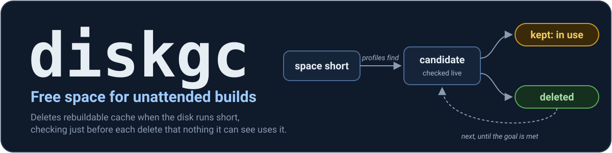
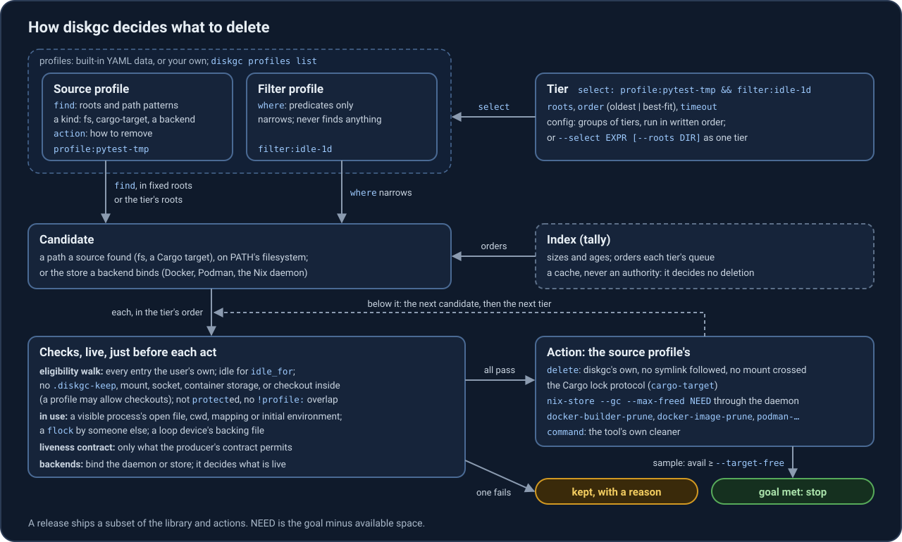
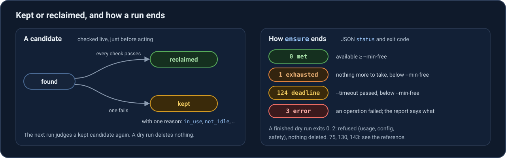

<p align="center"></p>

[](LICENSE) [](Cargo.toml) [](flake.nix) [](#for-agents-and-ci-hooks)

**diskgc brings a Linux filesystem up to a free-space goal by deleting rebuildable cache that, as far as it can tell, nothing is using.** Cargo `target/` directories, the `/tmp` leftovers of ended pytest and nix-shell sessions, and (from 0.2) dead Nix store paths and, in the project trees you name, pytest, Python bytecode and mypy caches, idle Python virtual environments and Node's compile cache, plus the pip, uv, pnpm and ccache caches through each tool's own cleaner: it takes them only when space runs short.

Unattended builds and coding agents fill disks overnight, and a full disk stops every job. Age-based cleanup (`find -mtime +N -delete`, systemd-tmpfiles age rules) runs by the clock, not when space is short, and checks no open files or sockets. diskgc checks each candidate on the live filesystem just before it acts:

- A candidate stays if a process diskgc can see has one of its files open, mapped, as its working directory, or named in its initial environment.
- A `/tmp` built-in deletes only what its producer's liveness contract permits, e.g. once the nix-shell that made the directory has ended.
- Every entry must belong to the user; a `.diskgc-keep` file or a mount inside keeps the candidate.
- No symlink is followed and no mount is crossed, when finding, walking or deleting.
- `--dry-run` reads only: it says what a reclaim would take, and why it keeps the rest.

One static binary, no daemon required, works as non-root.



## Quick start

Install a release package as [packaging/README.md](packaging/README.md) says. To try a dry run from a clone: `nix run . -- ensure --dry-run …`.

**Here and now**, e.g. before a job: a dry run first, then the same command.

```bash
diskgc ensure --dry-run --min-free 20G --select 'profile:pytest-tmp || profile:nix-shell-rc' /tmp
diskgc ensure --min-free 20G --select 'profile:pytest-tmp || profile:nix-shell-rc' /tmp
```

**In the background:** `watch`, one systemd instance per filesystem, from the packaged template and a configuration ([setup](docs/reference.md#watch-as-a-systemd-service)).

```bash
mkdir -p ~/.config/diskgc/watch
echo 'DISKGC_WATCH_ARGS=--min-free 30G --target-free 60G' > ~/.config/diskgc/watch/home.env
systemctl --user enable --now "diskgc-watch@$(systemd-escape --path /home).service"
```

0.2 runs a reclaiming `watch`: below `--min-free` it reclaims as `ensure` does, up to `--target-free`, and deletes nothing in between. On NixOS, the flake's `nixosModules.default` (`services.diskgc`) at a release tag runs that release's package and checks its configuration at build time ([module](docs/architecture.md#nixos-module)); from master it runs the gated development package, which does not delete.

## A dry run of /tmp

The release-candidate package (diskgc 0.2.0-dev (53e57ad), 2026-11-05) on a development laptop, with `--min-free` above the free space. Real output, trimmed at "…".

```console
$ diskgc ensure --dry-run --min-free 200G --select 'profile:pytest-tmp || profile:nix-shell-rc' /tmp
…
dry run: 104.3 GiB available on / (min-free 200.0 GiB, target-free 200.0 GiB); would reclaim 131707 of 131707 eligible, est. 901.4 MiB of 95.7 GiB needed: short of the goal by 94.8 GiB by estimate; 519 kept (took 182.837 s):
  profile pytest-tmp: 387 found · 52 eligible est. 113.5 MiB (would reclaim 52) · kept 331 future_time est. 3.5 GiB, 3 contains_special unsized, 1 in_use est. 14.9 MiB
  profile nix-shell-rc: 131839 found · 131655 eligible est. 787.9 MiB (would reclaim 131655) · kept 71 producer_unknown est. 380.0 KiB, 15 in_use est. 84.0 KiB, 52 not_idle est. 376.0 KiB, 45 missing unsized, 1 contains_ipc unsized
  …
  16 kept: in_use; examples: /tmp/pytest-of-mpedersen/pytest-1055, … (11 more); e.g. used by pid 2200 (gcr-ssh-agent), pid 2201 (gitlab-runner), pid 2202 (bash) and 192 more
  …
```

Nothing was deleted; the dry run exited 0. Without `--dry-run`, `ensure` checks each candidate again just before deleting it, and stops once `--target-free` (by default `--min-free`) is available.



## For agents and CI hooks

Call `ensure` before each job, and branch on its exit code and report:

```bash
diskgc ensure --json --min-free 50G \
  --select 'profile:cargo-target && filter:idle-1d' \
  --roots "$CI_BUILDS_DIR" "$CI_BUILDS_DIR"
```

- `--json` prints exactly one JSON object on stdout for every exit, when stdout accepts the write.
- [Exit codes](docs/reference.md#exit-codes-ensure): `0` met, `1` exhausted, `2` usage, configuration, safety or provisioning refusal (nothing deleted), `3` error, `75` another reclaim held the lock (retry later), `124` deadline, `130`/`143` signal.
- Scripts match `status`, `cause` and the exit code; message text is for people.
- Complete hooks: [ci-pre-job.sh](docs/ci-pre-job.sh) and [agent-pre-job.py](docs/agent-pre-job.py).

## Safety and testing

- The default package (`nix run .`) is a development build: it deletes only inside diskgc's test containers ([sandbox gate](docs/safety.md#pre-release-sandbox-gate)). `.#release-candidate` lifts the gate; built from master it is for disposable test containers only.
- `check`, `profiles` and `--dry-run` work anywhere, as does `survey`, which only development builds have.
- Destructive tests run only in rootless Podman containers and NixOS VMs, never against the developer's filesystem.
- `nix develop -c just check` runs formatting, lints, unit and integration tests. `nix develop -c just e2e` is the commit gate: check, flake checks, container and VM tests; it needs rootless Podman ([container setup](docs/testing.md#container-setup)). `nix develop -c just --list` shows every recipe.
- Run a dry run first, on the host: in its own PID namespace (most containers) or under `hidepid`, diskgc cannot see every process and refuses to reclaim.
- To contribute, read [PRD.md](PRD.md) and the document it names for the rule you change.

## When not to use diskgc

- Disk usage analysis: use `ncdu` or `nix-du`.
- Btrfs or ZFS with snapshots, where deleting may free nothing; network filesystems.
- Removing Nix generations or profiles, Docker volumes or containers.
- Defending against a hostile local user who races it.
- Non-Linux, or Linux older than 5.8.

## Documentation

- [PRD](PRD.md): what diskgc is for, what it guarantees and what it does not. Read it first.
- [Reference](docs/reference.md): commands, exit codes, JSON output, configuration, profiles, the [built-in library](docs/reference.md#built-in-profile-library), and the draft release notes; a release takes what its release notes say.
- [Safety](docs/safety.md): every check made before anything is deleted.
- [Architecture](docs/architecture.md): index, tally, reclaim walk, deployment, the release procedure.
- [Testing](docs/testing.md): test layers, scenarios and the `just` recipes.
- [Package README](packaging/README.md): install and first run from a release package, which ships it as `share/doc/diskgc/README.md`.
- Source: `crates/` (the Rust workspace), `diskgc-e2e/` (the container test harness), `packaging/` (what the packages install beside the binary).

## Related tools

Nix's `min-free` (only during Nix builds) and `nix-collect-garbage`, [cargo-sweep](https://github.com/holmgr/cargo-sweep) (by age), Docker's `builder.gc` policy (by size) and systemd-tmpfiles (by age) each clean one ecosystem; diskgc is the coordinator, with one free-space goal and one ordered policy across them ([PRD, Prior art](PRD.md#prior-art-and-why-it-is-not-enough)). [nix-better-gc](https://github.com/eisbaw/nix-better-gc) plans a size-targeted, oldest-first Nix store GC.

## License

MIT, see [LICENSE](LICENSE).
